# Concept gallery — approved winner paintings

The approved concept art of the v2 art round: every winner painting of the picker era that is lore-
worthy on screen — the boss portraits, the ending and front-end moments, and the zone scene paintings —
as web-safe previews. This is documentation, not game data: nothing here is packed into the atlas, and
the simulation never reads it.

Each preview is the committed winner PNG area-downscaled to at most 512 px on the long side and
written as an indexed PNG of at most 256 colours (the ingest tool's own `scale.mjs` /
`quantise.mjs` / `codec.mjs`, no dither). The originals — every file with its full provenance sidecar
(model, prompt, seed, slot, date) — stay in `art-prompts/v2/winners/`, which is outside the workspace
and is not part of any build.

- Pieces: 41 — committed preview bytes: 2.50 MB (budget 10 MB).
- Not included: store surfaces (logo, promo, posters) — those belong to the store package; and
  the keyed sprite/layer contact sheets, whose landed game art has its own plates in
  [`../enemies/`](../enemies/), [`../bosses/`](../bosses/) and [`../items/`](../items/).

| Preview | Subject | Category | Model class | Original (provenance sidecar beside it) |
| --- | --- | --- | --- | --- |
| [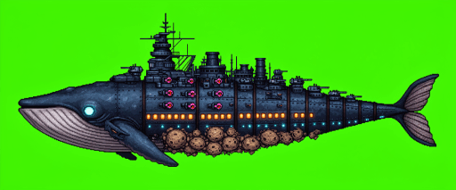](<boss-abyss-ark.png>) | boss/abyss-ark — ABYSS ARK (AA-09) — zone I boss, the thirteen-section whale flagship; full body on key green | boss | flux2 (`black-forest-labs/FLUX.2-dev`) | [`boss/abyss-ark`](<../../../art-prompts/v2/winners/boss/abyss-ark/winner.png>) 1536x640 · generated 2026-10-17 |
| [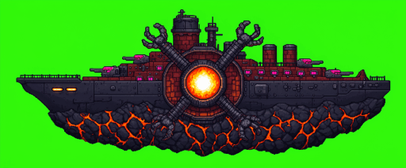](<boss-cinder-bastion.png>) | boss/cinder-bastion — CINDER BASTION (CB-04) — zone D boss, the magma-shaft battleship with four revolving arms; full body on key green | boss | flux2 (`black-forest-labs/FLUX.2-dev`) | [`boss/cinder-bastion`](<../../../art-prompts/v2/winners/boss/cinder-bastion/winner.png>) 1536x640 · generated 2026-10-17 |
| [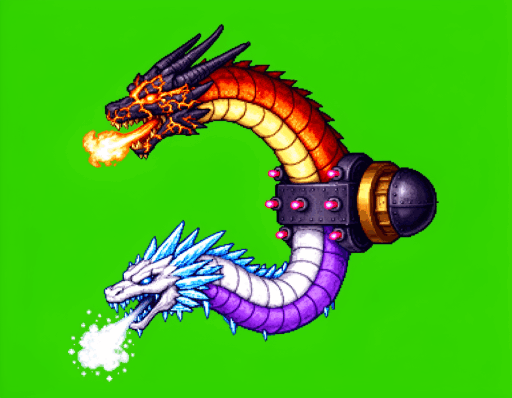](<boss-ember-frost-twins.png>) | boss/ember-frost-twins — EMBER & FROST TWINS — double boss, two serpent heads on one shared yoke; full body on key green | boss | flux2 (`black-forest-labs/FLUX.2-dev`) | [`boss/ember-frost-twins`](<../../../art-prompts/v2/winners/boss/ember-frost-twins/winner.png>) 1152x896 · generated 2026-10-17 |
| [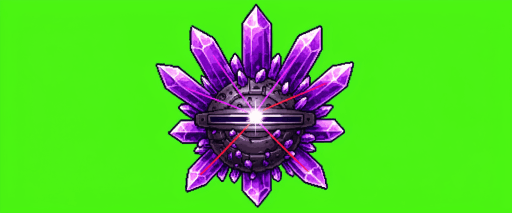](<boss-facet-monarch.png>) | boss/facet-monarch — FACET MONARCH (FM-07) — zone G boss, the crystal core with an orbiting crown; full body on key green | boss | flux2 (`black-forest-labs/FLUX.2-dev`) | [`boss/facet-monarch`](<../../../art-prompts/v2/winners/boss/facet-monarch/winner.png>) 1536x640 · generated 2026-10-17 |
| [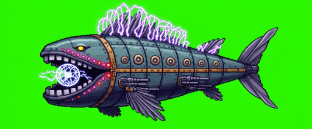](<boss-galvanic-maw.png>) | boss/galvanic-maw — GALVANIC MAW (GM-02) — zone B boss, the screen-sized mechanical fish; full body on key green | boss | flux2 (`black-forest-labs/FLUX.2-dev`) | [`boss/galvanic-maw`](<../../../art-prompts/v2/winners/boss/galvanic-maw/winner.png>) 1536x640 · generated 2026-10-17 |
| [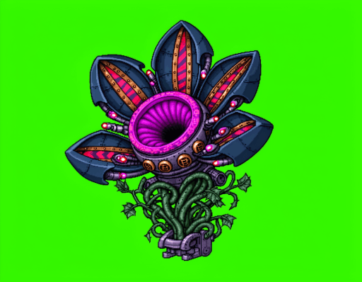](<boss-grasping-bloom.png>) | boss/grasping-bloom — GRASPING BLOOM — extra boss, the armored suction flower; full body on key green | boss | flux2 (`black-forest-labs/FLUX.2-dev`) | [`boss/grasping-bloom`](<../../../art-prompts/v2/winners/boss/grasping-bloom/winner.png>) 1152x896 · generated 2026-10-17 |
| [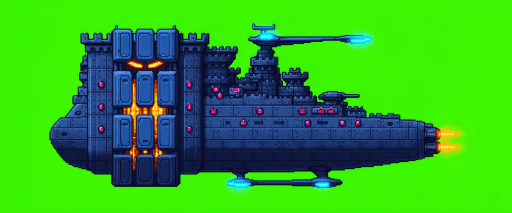](<boss-halcyon-bulwark.png>) | boss/halcyon-bulwark — HALCYON BULWARK (HB-01) — zone A boss, the armored-plate fortress-ship; full body on key green | boss | flux2 (`black-forest-labs/FLUX.2-dev`) | [`boss/halcyon-bulwark`](<../../../art-prompts/v2/winners/boss/halcyon-bulwark/winner.png>) 1536x640 · generated 2026-10-17 |
| [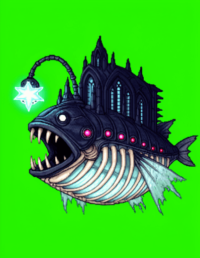](<boss-hollow-king.png>) | boss/hollow-king — THE HOLLOW KING (HK-10) — final boss inside the Ark, the anglerfish lure-cathedral; full body on key green | boss | flux2 (`black-forest-labs/FLUX.2-dev`) | [`boss/hollow-king`](<../../../art-prompts/v2/winners/boss/hollow-king/winner.png>) 896x1152 · generated 2026-10-17 |
| [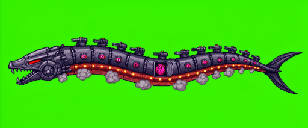](<boss-iron-leviathan.png>) | boss/iron-leviathan — IRON LEVIATHAN — raid boss, the eel-battleship raider (with the LEVIATHAN HEART inside); full body on key green | boss | flux2 (`black-forest-labs/FLUX.2-dev`) | [`boss/iron-leviathan`](<../../../art-prompts/v2/winners/boss/iron-leviathan/winner.png>) 1536x640 · generated 2026-10-17 |
| [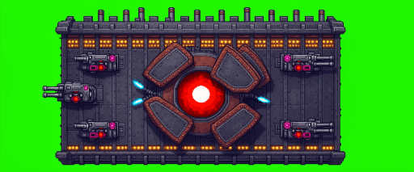](<boss-iron-sovereign.png>) | boss/iron-sovereign — IRON SOVEREIGN (IS-08) — zone H boss, the steel slab with rotating shield plates; full body on key green | boss | flux2 (`black-forest-labs/FLUX.2-dev`) | [`boss/iron-sovereign`](<../../../art-prompts/v2/winners/boss/iron-sovereign/winner.png>) 1536x640 · generated 2026-10-17 |
| [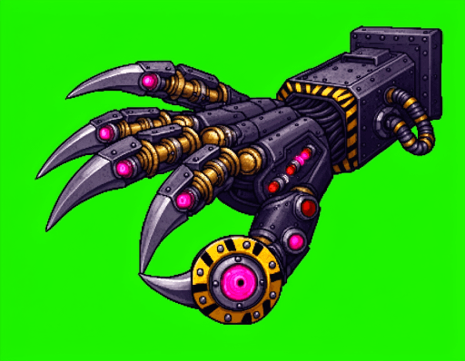](<boss-iron-talon.png>) | boss/iron-talon — IRON TALON — extra boss, the sky fortress's grabbing claw; full body on key green | boss | flux2 (`black-forest-labs/FLUX.2-dev`) | [`boss/iron-talon`](<../../../art-prompts/v2/winners/boss/iron-talon/winner.png>) 1152x896 · generated 2026-10-17 |
| [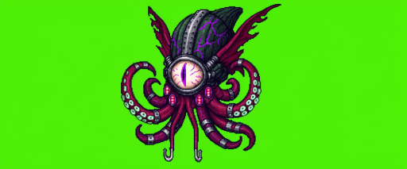](<boss-mantle-regent.png>) | boss/mantle-regent — MANTLE REGENT (MR-06) — zone F boss, the one-eyed tentacle tyrant; full body on key green | boss | flux2 (`black-forest-labs/FLUX.2-dev`) | [`boss/mantle-regent`](<../../../art-prompts/v2/winners/boss/mantle-regent/winner.png>) 1536x640 · generated 2026-10-17 |
| [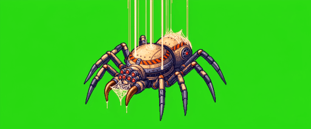](<boss-sandgrave-widow.png>) | boss/sandgrave-widow — SANDGRAVE WIDOW (SW-03) — zone C boss, the silk-hung spider fortress; full body on key green | boss | flux2 (`black-forest-labs/FLUX.2-dev`) | [`boss/sandgrave-widow`](<../../../art-prompts/v2/winners/boss/sandgrave-widow/winner.png>) 1536x640 · generated 2026-10-17 |
| [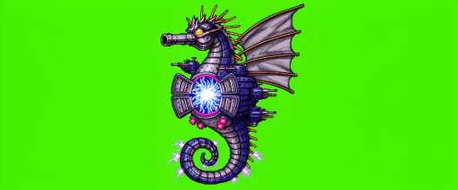](<boss-squall-steed.png>) | boss/squall-steed — SQUALL STEED (SS-05) — zone E boss, the storm seahorse fortress; full body on key green | boss | flux2 (`black-forest-labs/FLUX.2-dev`) | [`boss/squall-steed`](<../../../art-prompts/v2/winners/boss/squall-steed/winner.png>) 1536x640 · generated 2026-10-17 |
| [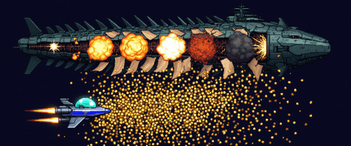](<moment-boss-death.png>) | moment/boss-death — Boss death — chained hull explosions while every bullet turns to gold | moment | flux2 (`black-forest-labs/FLUX.2-dev`) | [`moment/boss-death`](<../../../art-prompts/v2/winners/moment/boss-death/winner.png>) 1536x640 · generated 2026-10-17 |
| [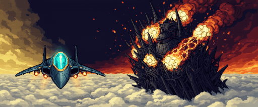](<moment-ending-citadel-falls.png>) | moment/ending-citadel-falls — Ending "The Citadel Falls" — the fortress burning behind a fighter flying hard toward camera | moment | flux2 (`black-forest-labs/FLUX.2-dev`) | [`moment/ending-citadel-falls`](<../../../art-prompts/v2/winners/moment/ending-citadel-falls/winner.png>) 1536x640 · generated 2026-10-17 |
| [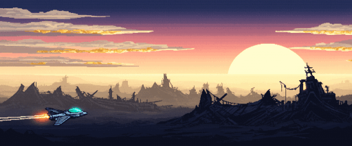](<moment-ending-citadel-falls-silent.png>) | moment/ending-citadel-falls-silent — Ending "The Citadel Falls Silent" — dawn flight home under a pale-gold half-sun | moment | flux2 (`black-forest-labs/FLUX.2-dev`) | [`moment/ending-citadel-falls-silent`](<../../../art-prompts/v2/winners/moment/ending-citadel-falls-silent/winner.png>) 1536x640 · generated 2026-10-17 |
| [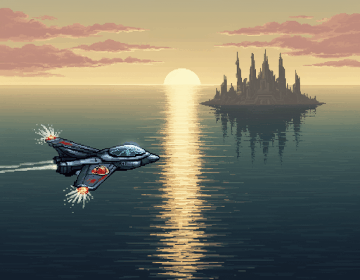](<moment-ending-citadel-falls-silent-second-panel.png>) | moment/ending-citadel-falls-silent/second-panel — Ending "The Citadel Falls Silent" — second panel (closer / later moment) | moment | flux2 (`black-forest-labs/FLUX.2-dev`) | [`moment/ending-citadel-falls-silent/second-panel`](<../../../art-prompts/v2/winners/moment/ending-citadel-falls-silent/second-panel/winner.png>) 1152x896 · generated 2026-10-17 |
| [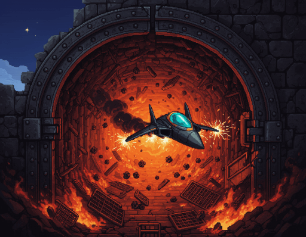](<moment-ending-citadel-falls-second-panel.png>) | moment/ending-citadel-falls/second-panel — Ending "The Citadel Falls" — second panel (closer / later moment) | moment | flux2 (`black-forest-labs/FLUX.2-dev`) | [`moment/ending-citadel-falls/second-panel`](<../../../art-prompts/v2/winners/moment/ending-citadel-falls/second-panel/winner.png>) 1152x896 · generated 2026-10-17 |
| [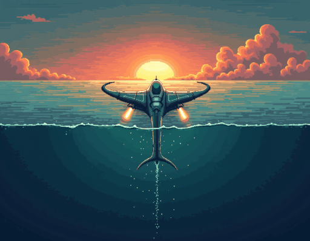](<moment-ending-deep-is-still.png>) | moment/ending-deep-is-still — Ending "The Deep Is Still" — rising through black water into sunrise | moment | flux1 (`black-forest-labs/FLUX.1-dev`) | [`moment/ending-deep-is-still`](<../../../art-prompts/v2/winners/moment/ending-deep-is-still/winner.png>) 1152x896 · generated 2026-10-17 |
| [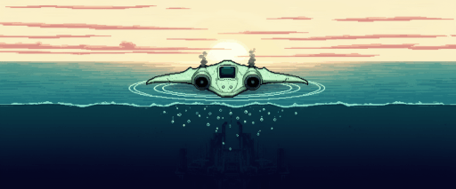](<moment-ending-deep-is-still-second-panel.png>) | moment/ending-deep-is-still/second-panel — Ending "The Deep Is Still" — second panel (closer / later moment) | moment | flux2 (`black-forest-labs/FLUX.2-dev`) | [`moment/ending-deep-is-still/second-panel`](<../../../art-prompts/v2/winners/moment/ending-deep-is-still/second-panel/winner.png>) 1536x640 · generated 2026-10-17 |
| [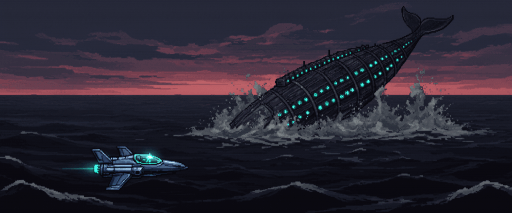](<moment-ending-flagship-slips-away.png>) | moment/ending-flagship-slips-away — Ending "The Flagship Slips Away" — the Abyss Ark diving free into the dark | moment | flux2 (`black-forest-labs/FLUX.2-dev`) | [`moment/ending-flagship-slips-away`](<../../../art-prompts/v2/winners/moment/ending-flagship-slips-away/winner.png>) 1536x640 · generated 2026-10-17 |
| [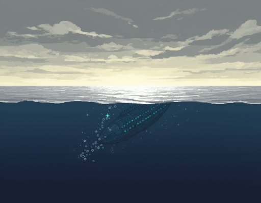](<moment-ending-flagship-slips-away-second-panel.png>) | moment/ending-flagship-slips-away/second-panel — Ending "The Flagship Slips Away" — second panel (closer / later moment) | moment | flux2 (`black-forest-labs/FLUX.2-dev`) | [`moment/ending-flagship-slips-away/second-panel`](<../../../art-prompts/v2/winners/moment/ending-flagship-slips-away/second-panel/winner.png>) 1152x896 · generated 2026-10-17 |
| [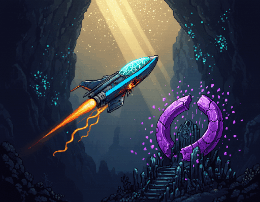](<moment-ending-throne-is-broken.png>) | moment/ending-throne-is-broken — Ending "The Throne Is Broken" — a battered fighter climbing out of the abyss trench | moment | flux2 (`black-forest-labs/FLUX.2-dev`) | [`moment/ending-throne-is-broken`](<../../../art-prompts/v2/winners/moment/ending-throne-is-broken/winner.png>) 1152x896 · generated 2026-10-17 |
| [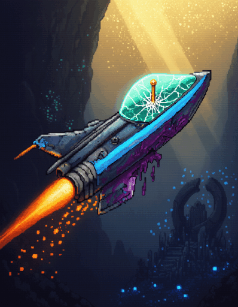](<moment-ending-throne-is-broken-second-panel.png>) | moment/ending-throne-is-broken/second-panel — Ending "The Throne Is Broken" — second panel (closer / later moment) | moment | flux2 (`black-forest-labs/FLUX.2-dev`) | [`moment/ending-throne-is-broken/second-panel`](<../../../art-prompts/v2/winners/moment/ending-throne-is-broken/second-panel/winner.png>) 896x1152 · generated 2026-10-17 |
| [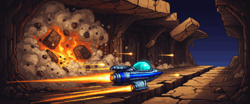](<moment-escape-run.png>) | moment/escape-run — Escape run — the corridor collapsing behind a sprinting fighter | moment | flux2 (`black-forest-labs/FLUX.2-dev`) | [`moment/escape-run`](<../../../art-prompts/v2/winners/moment/escape-run/winner.png>) 1536x640 · generated 2026-10-17 |
| [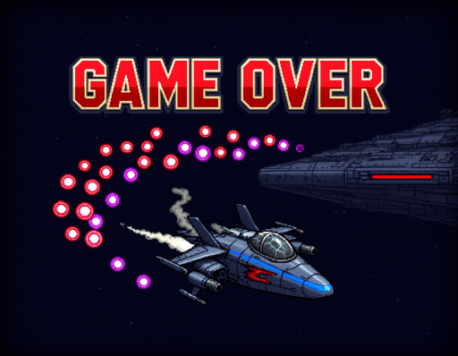](<moment-game-over.png>) | moment/game-over — GAME OVER card — frozen bullet storm around a drifting wreck | moment | flux2 (`black-forest-labs/FLUX.2-dev`) | [`moment/game-over`](<../../../art-prompts/v2/winners/moment/game-over/winner.png>) 1152x896 · generated 2026-10-17 |
| [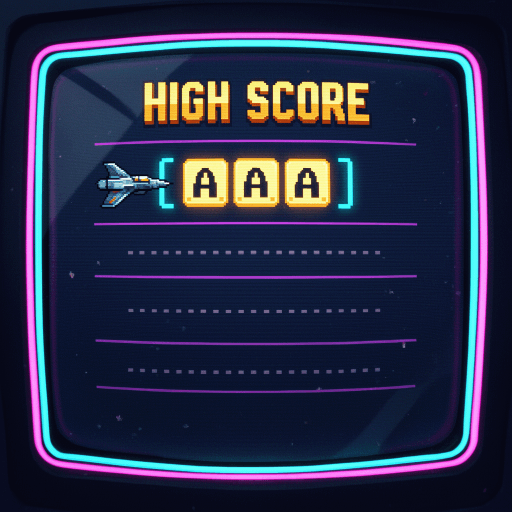](<moment-hi-score-entry.png>) | moment/hi-score-entry — Hi-score entry — neon ranking board with the three-letter slot lit | moment | flux2 (`black-forest-labs/FLUX.2-dev`) | [`moment/hi-score-entry`](<../../../art-prompts/v2/winners/moment/hi-score-entry/winner.png>) 1024x1024 · generated 2026-10-17 |
| [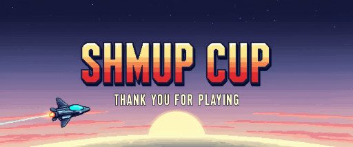](<moment-victory-card.png>) | moment/victory-card — Victory / credits end-card — dawn, one ship and the logo | moment | flux2 (`black-forest-labs/FLUX.2-dev`) | [`moment/victory-card`](<../../../art-prompts/v2/winners/moment/victory-card/winner.png>) 1536x640 · generated 2026-10-17 |
| [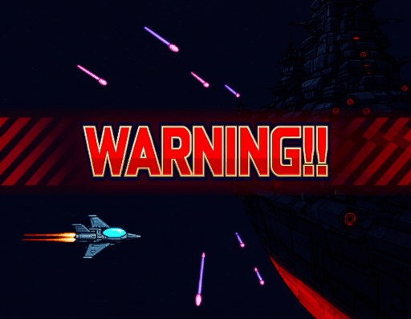](<moment-warning-screen.png>) | moment/warning-screen — Boss WARNING screen — darkened field, giant red "WARNING" text, siren light | moment | flux2 (`black-forest-labs/FLUX.2-dev`) | [`moment/warning-screen`](<../../../art-prompts/v2/winners/moment/warning-screen/winner.png>) 1152x896 · generated 2026-10-17 |
| [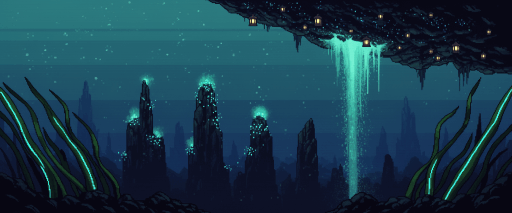](<stage-abyssal-throne.png>) | stage/abyssal-throne — ABYSSAL THRONE — zone I stage, wide establishing wallpaper (sets the zone's look for its parallax layers) | stage | flux2 (`black-forest-labs/FLUX.2-dev`) | [`stage/abyssal-throne`](<../../../art-prompts/v2/winners/stage/abyssal-throne/winner.png>) 1536x640 · generated 2026-10-17 |
| [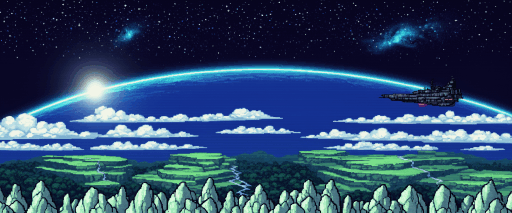](<stage-azure-verge.png>) | stage/azure-verge — AZURE VERGE — zone A stage, wide establishing wallpaper (sets the zone's look for its parallax layers) | stage | flux2 (`black-forest-labs/FLUX.2-dev`) | [`stage/azure-verge`](<../../../art-prompts/v2/winners/stage/azure-verge/winner.png>) 1536x640 · generated 2026-10-17 |
| [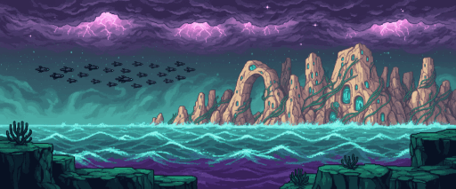](<stage-brine-nebula.png>) | stage/brine-nebula — BRINE NEBULA — zone B stage, wide establishing wallpaper (sets the zone's look for its parallax layers) | stage | flux2 (`black-forest-labs/FLUX.2-dev`) | [`stage/brine-nebula`](<../../../art-prompts/v2/winners/stage/brine-nebula/winner.png>) 1536x640 · generated 2026-10-17 |
| [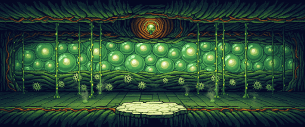](<stage-cell-vault.png>) | stage/cell-vault — CELL VAULT — zone F stage, wide establishing wallpaper (sets the zone's look for its parallax layers) | stage | flux2 (`black-forest-labs/FLUX.2-dev`) | [`stage/cell-vault`](<../../../art-prompts/v2/winners/stage/cell-vault/winner.png>) 1536x640 · generated 2026-10-17 |
| [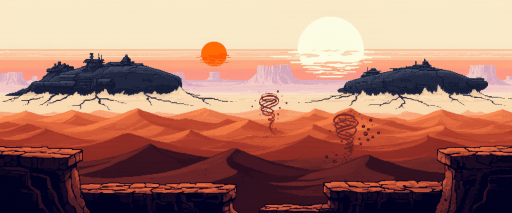](<stage-dune-expanse.png>) | stage/dune-expanse — DUNE EXPANSE — zone C stage, wide establishing wallpaper (sets the zone's look for its parallax layers) | stage | flux2 (`black-forest-labs/FLUX.2-dev`) | [`stage/dune-expanse`](<../../../art-prompts/v2/winners/stage/dune-expanse/winner.png>) 1536x640 · generated 2026-10-17 |
| [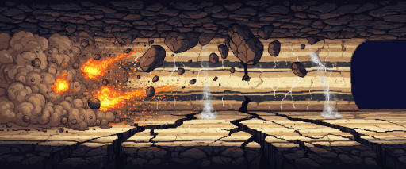](<stage-escape-corridor.png>) | stage/escape-corridor — ESCAPE CORRIDOR — the final-zone collapse run, wide wallpaper | stage | flux2 (`black-forest-labs/FLUX.2-dev`) | [`stage/escape-corridor`](<../../../art-prompts/v2/winners/stage/escape-corridor/winner.png>) 1536x640 · generated 2026-10-17 |
| [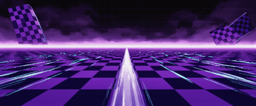](<stage-high-speed-dimension.png>) | stage/high-speed-dimension — HIGH-SPEED DIMENSION — the Mode-7 checkerboard bonus dimension, wide wallpaper | stage | flux2 (`black-forest-labs/FLUX.2-dev`) | [`stage/high-speed-dimension`](<../../../art-prompts/v2/winners/stage/high-speed-dimension/winner.png>) 1536x640 · generated 2026-10-17 |
| [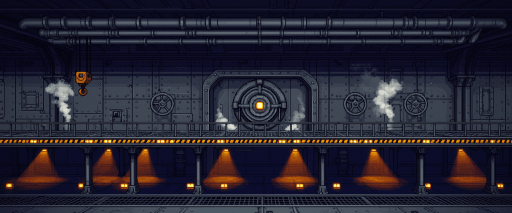](<stage-iron-citadel.png>) | stage/iron-citadel — IRON CITADEL — zone H stage, wide establishing wallpaper (sets the zone's look for its parallax layers) | stage | flux2 (`black-forest-labs/FLUX.2-dev`) | [`stage/iron-citadel`](<../../../art-prompts/v2/winners/stage/iron-citadel/winner.png>) 1536x640 · generated 2026-10-17 |
| [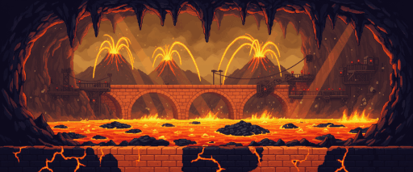](<stage-magma-deep.png>) | stage/magma-deep — MAGMA DEEP — zone D stage, wide establishing wallpaper (sets the zone's look for its parallax layers) | stage | flux2 (`black-forest-labs/FLUX.2-dev`) | [`stage/magma-deep`](<../../../art-prompts/v2/winners/stage/magma-deep/winner.png>) 1536x640 · generated 2026-10-17 |
| [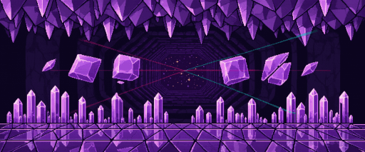](<stage-prism-labyrinth.png>) | stage/prism-labyrinth — PRISM LABYRINTH — zone G stage, wide establishing wallpaper (sets the zone's look for its parallax layers) | stage | flux2 (`black-forest-labs/FLUX.2-dev`) | [`stage/prism-labyrinth`](<../../../art-prompts/v2/winners/stage/prism-labyrinth/winner.png>) 1536x640 · generated 2026-10-17 |
| [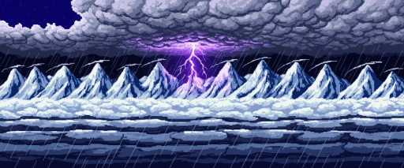](<stage-tempest-ridge.png>) | stage/tempest-ridge — TEMPEST RIDGE — zone E stage, wide establishing wallpaper (sets the zone's look for its parallax layers) | stage | flux2 (`black-forest-labs/FLUX.2-dev`) | [`stage/tempest-ridge`](<../../../art-prompts/v2/winners/stage/tempest-ridge/winner.png>) 1536x640 · generated 2026-10-17 |
